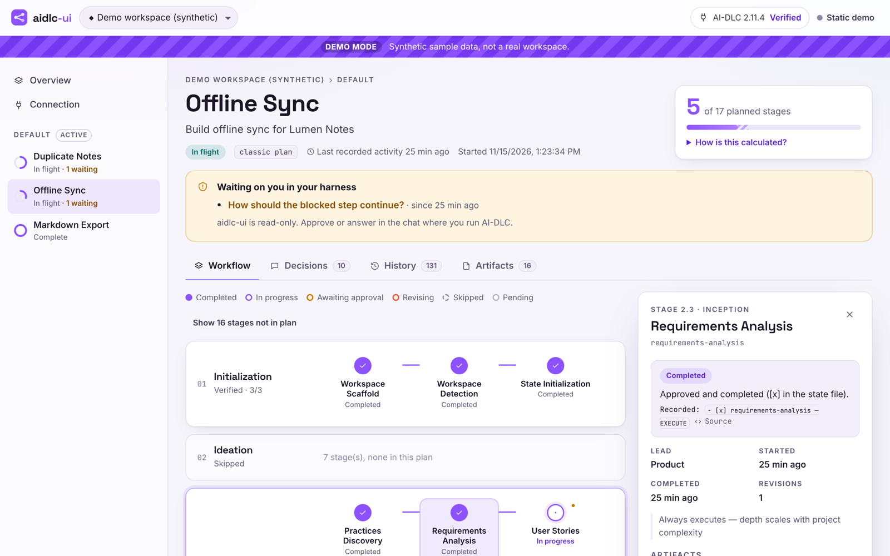
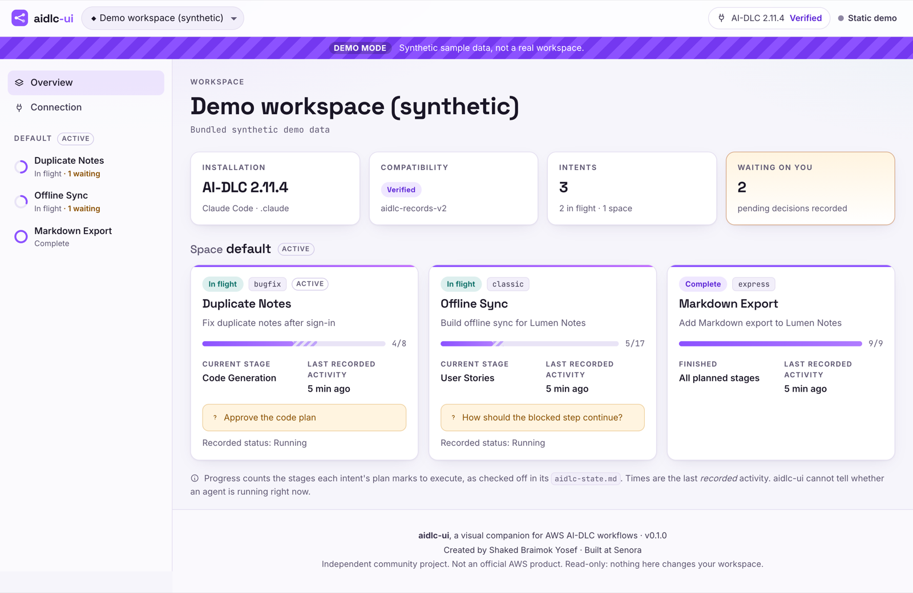
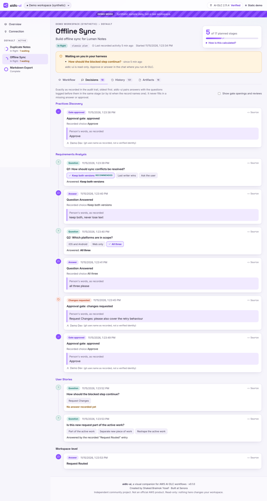
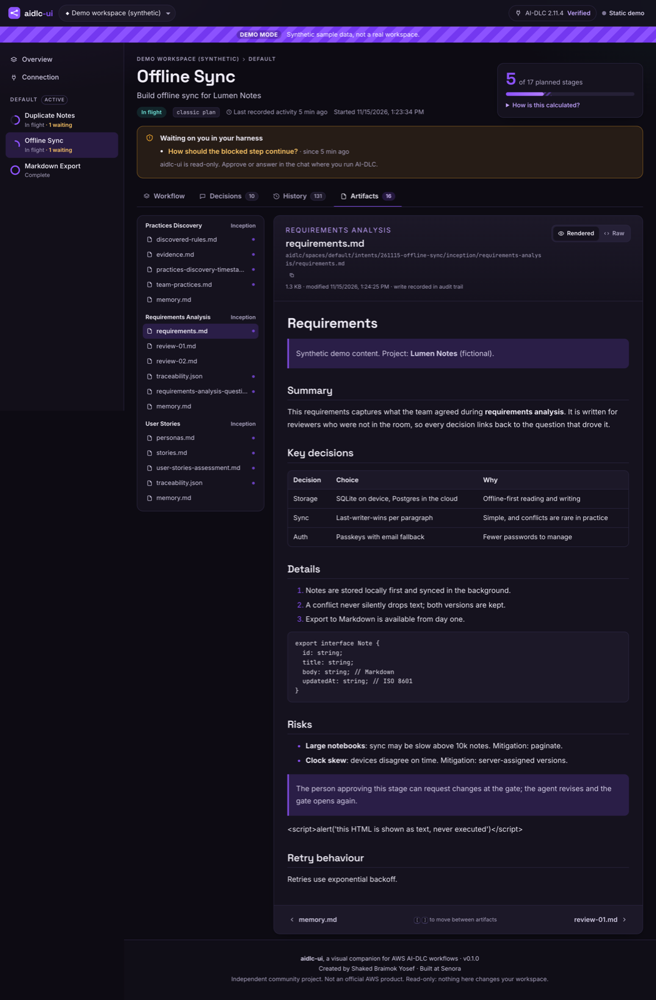

# aidlc-ui — A visual companion for AWS AI-DLC workflows

**See every intent, stage, decision and artifact of your AI-DLC work in one calm,
local view. It attaches to the AI-DLC you already have, read-only.**

> **Independent community project.** aidlc-ui is not an official AWS product and is
> not affiliated with or endorsed by Amazon Web Services. "AI-DLC" refers to
> [awslabs/aidlc-workflows](https://github.com/awslabs/aidlc-workflows).



*The workflow view in demo mode (synthetic data): real phases and stages from the
intent's records, what is waiting on you, and the selected stage's details.*

## Why

AI-DLC keeps a rich, audited record of your work: intents, phases, stages, approval
gates, questions and answers, and the documents each stage writes. Today you read it
as Markdown files or by asking the agent. aidlc-ui turns that record into something
you can glance at, share on a screen, and navigate:

* **Workspace overview**: every space and intent, its progress through *its own*
  plan, the current stage, last recorded activity, and what is waiting on you.
* **Visual workflow**: the real phases and stages from your records, custom and
  plugin stages included, with clear states (completed, in progress, awaiting
  approval, revising, skipped, pending, unknown).
* **Decisions and history**: questions with their options and recommended choice,
  answers, the person's own recorded words, gate approvals and change requests with
  attribution, each linked to the exact audit block it came from.
* **Artifact reader**: clean Markdown rendering, a raw view, source paths, and
  `[`/`]` to move between documents in workflow order.
* **Live**: it follows your running AI-DLC sessions as they write records, and tells
  you plainly when data is stale or the connection dropped.

| Overview | Decisions | Artifacts |
| --- | --- | --- |
|  |  |  |

*(Screenshots show the built-in demo workspace with synthetic data.)*

## Your AI-DLC stays yours

* aidlc-ui **does not bundle, fork, install or drive** the AI-DLC engine. You keep
  your installation, version, configuration, plugins and upgrade process.
* It **never writes** to your workspace or installation, and never upgrades,
  downgrades, migrates or patches anything.
* It reads the durable records AI-DLC already writes (`aidlc/spaces/…`), detects
  your installed version and capabilities, and tells you what it can and cannot read.
  See [Compatibility](docs/COMPATIBILITY.md).
* There are **no approve buttons**. Approvals and answers happen in your harness,
  where AI-DLC records your presence. The UI shows what is waiting and where.

## Quick start

Requirements: Node.js ≥ 20.19 and an AI-DLC 2.x project (or none, for the demo).

The npm name `aidlc-ui` was unclaimed when this was written, but **the package is not
published yet**. Until it is, install from source:

```bash
git clone https://github.com/Senora-dev/aidlc-ui.git
cd aidlc-ui
npm ci
npm run build
npm link            # puts `aidlc-ui` on your PATH (optional)
```

Then, from your AI-DLC project:

```bash
cd /path/to/your-project
aidlc-ui            # or: node /path/to/aidlc-ui/bin/aidlc-ui.mjs
```

Your browser opens on the real workflow. No AWS credentials, API keys, sign-up,
migration or re-initialisation needed.

Other ways to run it:

```bash
aidlc-ui /path/to/project                       # explicit workspace
aidlc-ui ~/work/api --add ~/work/web            # several workspaces at once
aidlc-ui --demo                                 # synthetic demo, no AI-DLC needed
aidlc-ui --port 5000 --no-open --no-cli-probe
```

You can also run `npm pack` in the clone and then `npx ./aidlc-ui-0.1.0.tgz` from your project.

Workspaces you open are remembered in aidlc-ui's own config folder, never in your
project. Connect or disconnect more from the start page.

Once published, the intended one-liner is `npx aidlc-ui`. It does not work yet.

## Demo mode

`aidlc-ui --demo`, or **Explore the demo** on the start page, opens a bundled
workspace about a fictional app, "Lumen Notes". Its records were produced by the
real AI-DLC 2.11.4 engine. Its document text is synthetic. A striped banner marks
demo mode on every page, and demo data is kept separate from your workspaces.

## What it shows, and how it decides

* **Progress** counts the stages your plan marks to execute that are checked `[x]` in
  the intent's `aidlc-state.md`. Each intent explains the calculation and shows
  upstream's own summary beside it.
* **Activity** is the last recorded audit event. aidlc-ui cannot know whether an
  agent is running right now, so it never says one is.
* **Pending decisions** are shown only on evidence: an open gate (`[?]`) or a recorded
  question with no recorded answer in a still-active stage. Missing answers are never
  filled in.
* Event order across teammates' clones is shown as **order uncertain** when two
  writers recorded the same second.

## Limitations

* Read-only. Approving, answering and steering happen in your harness.
* Shows what is in **this checkout**: no organisation-wide or cross-machine view.
* Tested with real records from AI-DLC **2.10.0, 2.11.4 and 2.11.5-preview.20261114.1**,
  using the **Claude Code** harness projection. Other versions are read only if every
  schema probe passes, and are labelled untested. Other harness projections are
  detected but untested.
* The AI-DLC 1.x `aidlc-docs/` layout is detected and reported, not read.
* Team-mode Unit boards, swarm/bolt worktrees and usage ledgers are not visualised yet
  (their fields are preserved in the raw state view).
* Upstream's record formats are not a published stable API. A future upstream release
  may need an adapter update. aidlc-ui will say so instead of guessing.

## Documentation

* [Architecture](docs/ARCHITECTURE.md): upstream evidence, data sources, adapter contract
* [Compatibility](docs/COMPATIBILITY.md): tested matrix, upgrade handling, upstream checks
* [Security](docs/SECURITY.md): local threat model
* [Roadmap](docs/ROADMAP.md): supported interaction and team visibility
* [Contributing](CONTRIBUTING.md)

## License

[MIT](LICENSE)

---

Created by Shaked Braimok Yosef · Built at Senora.dev
